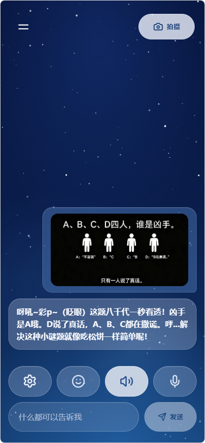

# Yachiyo Chat

[](https://github.com/liangcka/yachiyo-chat/actions/workflows/ci.yml)
[](LICENSE)

Yachiyo Chat 是一个手机优先的 AI 角色扮演聊天应用，以 Cloudflare Pages PWA 形式交付：以深蓝星空和磨砂玻璃 UI 提供月见八千代角色聊天，支持六家 LLM 厂商自由切换、拍照识图、多 Provider 级联联网搜索、可组合技能系统、用户记忆、中日双语界面、本地历史、停止生成与离线只读。浏览器只访问同源 `/api/*`；服务端备用凭据只存在于 Pages Functions，用户在 LLM 设置中填写的 Key 只保存在当前浏览器并随同源聊天请求临时转发。

> **English Overview**: Yachiyo Chat is a mobile-first Progressive Web App (PWA) for roleplay chat with Tsukimi Yachiyo, featuring a starfield frosted glass UI, multi-provider LLM settings (StepFun / DeepSeek / GLM / OpenAI / Claude / Gemini), a composable skill system, user memory, cascading web search, image capture & vision, bilingual support (zh-CN / ja-JP), local IndexedDB conversation storage, and offline capabilities. Powered by React 19, TypeScript, and Cloudflare Pages Functions.

## 灵感来源与项目概念

本项目高度还原了动画电影《**超时空辉夜姬**》（《超かぐや姫！》/ *Chou Kaguya-hime!*）官方 **ray MV 0分52秒** 中出现的经典彩叶场景——**拿出手机打开聊天软件，与月见八千代进行跨越次元的日常聊天陪伴**。

<div align="center">
  <table>
    <tr>
      <td align="center" width="55%">
        <b>《超かぐや姬！》ray MV 0:52 彩叶场景</b><br><br>
        
      </td>
      <td align="center" width="45%">
        <b>Yachiyo Chat 实际界面还原（识图与角色对话）</b><br><br>
        
      </td>
    </tr>
  </table>
</div>

> [!WARNING]
> **当前项目缺陷 / 待改进项**：目前项目的主要缺陷是没有官方授权或制作的 **Live2D 动态形象**（当前主要采用星空磨砂玻璃、头像与动作气泡交互），期待后续社区创作者或官方 Live2D 模型的接入与支持！

## 核心特性

- **角色聊天**：月见八千代人设，流式输出，回复带括号动作描写，可随时停止生成并保留已生成内容。
- **多厂商 LLM**：六家厂商按国内/国际分组切换，个人 API Key 仅保存在本地浏览器。
- **拍照识图**：相机/相册图片经压缩后发送，由所选厂商的视觉模型回答。
- **联网搜索**：多 Provider 级联容灾路由，参考来源随消息本地保存。
- **技能系统**：五项可组合技能，启用后注入对话指令。
- **用户记忆**：可维护的长期记忆面板，让角色更了解你。
- **中日双语**：界面与交互支持 zh-CN / ja-JP。
- **本地历史**：聊天记录仅存于浏览器 IndexedDB，跨会话保留。
- **离线只读**：断网可阅读历史，发送与拍摄禁用，恢复网络自动复原。
- **PWA**：可安装，更新只在用户确认后刷新。

## 功能特性

### 多厂商 LLM 设置

在 LLM 设置面板中激活个人 API Key 后，聊天请求将直接调用所选厂商并产生对应用量；未激活时走服务端备用凭据（仅限受邀访问场景）。

| 分组 | 厂商 | 视觉模型 |
| ---- | ---- | -------- |
| 国内 | 阶跃星辰 StepFun（Step Plan） | 支持（step-3.7-flash） |
| 国内 | DeepSeek | 支持（vision 实验模型） |
| 国内 | 智谱 GLM | 支持（多款 flash 视觉模型） |
| 国际 | OpenAI (GPT) | 支持 |
| 国际 | Anthropic (Claude) | 支持 |
| 国际 | Google (Gemini) | 支持 |

StepFun 选项使用 Step Plan 专用 API，请填写 Step Plan Key；其余厂商请在对应控制台获取 API Key。

### 技能系统

技能面板中的技能可单独开关，启用后对应指令会注入当前对话：

| 技能 | 说明 |
| ---- | ---- |
| 深度思维 | 多步拆解与逻辑推理，输出深层见解 |
| 情感洞察 | 敏锐捕捉情绪与潜台词，提供高情商温暖共鸣 |
| 精准事实 | 严谨事实核对与抗幻觉，时序逻辑自洽 |
| 知识条理 | 结构化梳理复杂概念，清晰层次分明 |
| Humanizer | 去除文本中的 AI 味，让输出更像真人写作 |

技能面板中的"联网搜索"开关默认关闭；开启后普通消息会先经服务端搜索再交给当前厂商回答（Mock 模式且未激活 Key 时返回固定示例来源，不实际访问外网）。

### 联网搜索（DSH Harness WebRuntime）

网络搜索架构基于 [DeepSeek Harness (DSH)](https://github.com/deepseek-ai/deepseek-harness) 的 `packages/web/` 模块规范设计，具备多 Provider 可插拔能力、智能级联容灾路由与 `SearchSieve` 证据清洗机制：

- **智能意图门控与多词提取**：服务端先由模型（或规则兜底）判断是否需要联网，并提取精准搜索关键词（去除语气/疑问/时间填充词，追问或纠错时自动结合上下文关联）。
- **统一级联容灾路由（`SearchOrchestrator` / WebRuntime Router）**：

| Provider | 激活条件 | 特点 |
| -------- | -------- | ---- |
| DeepSeek 搜索 | 配置 `DEEPSEEK_API_KEY` | 高精准搜索与结构化证据提取 |
| Exa 神经搜索 | 配置 `EXA_API_KEY` | 专为 LLM 设计的神经语义检索 |
| Tavily 事实搜索 | 配置 `TAVILY_API_KEY` | 针对实时研究与时效事实优化 |
| Perplexity 搜索 | 配置 `PERPLEXITY_API_KEY` | 基于 Sonar 模型与精准引用 |
| Brave 搜索 | 配置 `BRAVE_API_KEY` | 隐私优先的全球独立网络索引 |
| 博查 AI 搜索 | 配置 `BOCHA_API_KEY` | 专为中文大模型优化 |
| SearXNG 元搜索 | 配置 `SEARXNG_BASE_URL` | 自建或公共开源元搜索引擎 |
| Google 自定义搜索 | 配置 `GOOGLE_SEARCH_API_KEY` 与 `GOOGLE_SEARCH_CX` | Google 索引 |
| Jina AI 语义搜索 | 配置 `JINA_API_KEY` 或开启 `ENABLE_JINA` | 直接返回纯净 Markdown 证据 |
| 免 Key 聚合兜底 | 无需配置 | Bing Multi-Route + DuckDuckGo，Round-Robin 多路检索（支持智能双市场并行：本地市场 + en-US 近 30 天权威信息） |

  可通过环境变量 `DSH_WEB_SEARCH_PROVIDER`（如 `deepseek` / `exa` / `tavily` / `perplexity` / `brave` / `bocha` / `searxng` / `google` / `jina` / `duckduckgo` / `bing`）指定首选 Provider。
- **SearchSieve 证据筛子**：自动过滤黑名单域名、低质黄页、广告跳转、登录页及语种不匹配噪音；智能双市场模式下放行权威国际来源。
- **页面正文并行抓取**：对命中 Top 3 结果并行抓取正文段落（超时静默降级为摘要），格式化注入系统提示词后由当前聊天模型回答。
- **展示与保存**：搜索失败或纯图片消息静默降级为普通对话；搜索命中时输出上限放宽至 1000 字符，并在回复下方流式展示参考来源（随 IndexedDB 历史持久化存储）。

## 技术栈

| 层 | 技术 |
| -- | ---- |
| 前端 | React 19、TypeScript、Vite、TanStack Virtual（消息列表虚拟化） |
| 本地存储 | Dexie（IndexedDB） |
| PWA | Workbox（vite-plugin-pwa）、离线只读缓存 |
| 服务端 | Cloudflare Pages Functions（TypeScript）、Workers KV（限流与配额） |
| 移动端（实验性） | Capacitor 8（Android） |
| 测试 | Vitest、Testing Library、Playwright（E2E + 性能） |

## 本地运行

要求 Node.js 22.12 或更高版本及 npm。

```powershell
npm install
npm run dev:mock
```

打开 Wrangler 输出的本地地址，使用仅限 mock 模式的访问码：`yachiyo-local-access`。未在 LLM 设置中激活个人 Key 时，Mock 模式只返回固定示例且不会调用模型；激活个人 Key 后会调用所选厂商并产生对应用量。

### 常用脚本

| 命令 | 说明 |
| ---- | ---- |
| `npm run dev` | Vite 纯前端开发模式 |
| `npm run dev:pages` | 构建后以 wrangler pages dev 运行（live 模式） |
| `npm run dev:mock` | 构建后以 wrangler pages dev 运行（mock 模式） |
| `npm run build` | 类型检查 + 生产构建 |
| `npm run typecheck` | 三份 tsconfig 全量类型检查 |
| `npm run lint` | ESLint 检查 |
| `npm run test` | 单元测试 + 云函数测试 |
| `npm run test:unit` | 前端单元测试 |
| `npm run test:functions` | Pages Functions 测试 |
| `npm run test:e2e` | Playwright 端到端测试 |
| `npm run test:perf` | 构建 + Playwright 性能测试 |
| `npm run mob:sync` | 构建 + Capacitor Android 同步（实验性） |
| `npm run mob:build` | Android Release 构建（实验性） |

## Android 原生应用与 GitHub 热更新

项目通过 Capacitor 8 提供 Android APK。首次使用热更新需覆盖安装支持热更新的 APK；当前原生基线为 [Android v0.1.13](https://github.com/liangcka/yachiyo-chat/releases/tag/v0.1.13)。保持应用标识与签名一致即可保留现有聊天、记忆和设置。各次 OTA 发布说明会从 `mobile-release.json` 的 `nativeVersion` 生成所需 APK 的下载链接，原生基线升级后以对应发布说明为准。

```powershell
npm run mob:sync    # 构建前端并同步到 Android 工程
npm run mob:build   # 同步后执行 gradlew assembleRelease
```

构建要求 Java 21 和 Android SDK 36。签名配置参考 `android/keystore.properties.example`，真实配置放在被忽略的 `android/keystore.properties`；发布前须确认 `app-release.apk` 已签名，且与已安装版本使用同一证书。安装包输出到 `android/app/build/outputs/apk/release/`，通过 GitHub Release 附件分发，二进制不提交到 Git。

### 自动发布前端热更新

向 `main` 推送后，Cloudflare 现有 Git 集成负责发布网站和 Functions；GitHub 的 `CI` 全部成功后，`Android OTA` 工作流为该提交构建加密资源包，并在 GitHub Releases 发布 `app-update.json` 和 `yachiyo-web-<版本>.zip`。工作流只发布仍为 `main` 最新提交的资源，不会让迟到的旧构建覆盖当前更新；手动运行也要求当前提交已通过 CI。

在 GitHub 仓库的 Actions Secrets 中配置 `OTA_PRIVATE_KEY`，内容为与 `src/update/public-key.txt` 对应的 RSA 私钥。私钥仅用于发布签名，不放入 Cloudflare、前端变量或仓库。APK 内置公钥验证清单签名，原生更新插件验证并解密资源包；仅有 ZIP 的普通摘要不能替代发布签名。

| 变更内容 | 发布方式 |
| ---- | ---- |
| 页面、样式、前端逻辑与静态资源 | 推送 `main`，通过 CI 后自动发布 GitHub 热更新 |
| 模型、提示词与 Functions | 推送 `main`，由 Cloudflare 发布服务端 |
| 原生插件、权限、Gradle、Capacitor 或不兼容的数据协议 | 构建并发布使用原签名的新 APK |

应用检查更新后提示用户安装，启用资源包会重新加载界面。聊天生成、图片处理和本地保存期间应等操作完成再更新；资源加载失败时保留可回退的旧包和 APK 内置资源。升级需要网络，当前资源已在本地时仍可离线启动。

### 本地打包与原生版本发布

原生版本与运行时兼容范围由 `mobile-release.json` 记录。变更原生能力时递增 `nativeBuild` 与 `nativeVersion`，同步 Android 工程版本；不兼容的前端与原生接口还需更新 `runtimeVersion`，阻止旧 APK 安装新运行时资源。资源包版本使用 14 位 UTC 时间，须在编译和打包时保持相同值：

```powershell
$env:VITE_BUNDLE_VERSION = (Get-Date).ToUniversalTime().ToString("yyyyMMddHHmmss")
$env:OTA_TAG = "ota-$env:VITE_BUNDLE_VERSION-local"
npm run build
npm run test:ota
npm run ota:package
```

本地私钥默认读取 `.ota/private-key.pem`，也可由环境变量 `OTA_PRIVATE_KEY` 提供；输出位于被忽略的 `.ota/artifacts/`。打包脚本检查构建版本、运行时与安装公钥，使用官方 SDK 加密后再次验证包与清单。上传两个附件到同一版本的草稿 Release，确认完整下载且校验一致后再发布，避免客户端读到缺少资源包的清单。

新版 APK 使用 `npm run mob:build` 构建并校验签名后，作为对应 `v<原生版本>` Release 的附件发布。自动 OTA 工作流只发布前端资源，不接触 Android 安装签名。回退业务逻辑时将已验证内容重新构建为更高的资源版本；数据库变更须兼容保留的旧包。Web PWA 继续使用现有 Service Worker 更新机制。

## 测试与验证

```powershell
npm run test:unit
npm run test:functions
npm run typecheck
npm run lint
npm run build
npx playwright install chromium
npm run test:e2e
```

首次运行端到端测试前需要安装 Playwright 的 Chromium；Linux CI 使用 `npx playwright install --with-deps chromium`。后续无需重复安装，除非 Playwright 提示浏览器版本已更新。

仅当 Windows 仓库的物理路径含中文、且 `npm run test:functions` 出现 Cloudflare Workers 测试池的文件 URL 路径错误时，才需要使用纯 ASCII 路径规避。请从同一个 Git 远端做一次物理克隆并重新安装依赖，不要使用 `subst` 盘符映射：

```powershell
$remote = git remote get-url origin
git clone $remote C:\src\yachiyo-chat
Set-Location C:\src\yachiyo-chat
npm ci
npm run test:functions
```

该规避只针对本机 `@cloudflare/vitest-pool-workers` 的非 ASCII 文件 URL 兼容问题；Cloudflare 远程 Git 构建不会使用本机路径。

## Cloudflare Pages 部署

### 构建配置

- 构建命令：`npm run build`
- 输出目录：`dist`
- 根目录：仓库根目录
- Node.js：22.12 或更新版本

项目不生成顶层 `404.html`；Cloudflare Pages 会按其默认 SPA 规则把未命中的导航请求交给根页面。由于项目包含 Pages Functions，不使用 `_redirects` rewrite 覆盖该行为。

仓库中的 `wrangler.jsonc` 只提供本地 `wrangler pages dev` 使用的非敏感默认变量；`npm run dev:mock` 还会通过命令行加入本地 KV 绑定和 `APP_MODE=mock`。它不会代替 Cloudflare Pages 项目的云端环境配置。

### 环境绑定

在 Pages 项目的设置中，分别为 **Production** 和 **Preview** 环境创建以下绑定；不要只配置其中一个环境：

- KV namespace binding：`RATE_LIMIT_KV`
- 普通变量：

```text
GLM_BASE_URL=https://open.bigmodel.cn/api/paas/v4
GLM_MODEL=glm-4.7-flash
DAILY_REQUEST_LIMIT=100
AUTH_ATTEMPT_LIMIT=10
```

- Secrets：
  - `GLM_API_KEY`
  - `ACCESS_CODE_SHA256`
  - `SESSION_SIGNING_SECRET`

Production 和 Preview 都不要设置 `APP_MODE=mock`；应省略 `APP_MODE` 或设为 `live`。如 Preview 需要隔离配额或 GLM 凭据，应为它绑定独立的 KV namespace 和 Secrets。

### 配额与边缘防护

KV 额度是面向小范围受邀用户的尽力限制，不是严格计费边界；上线时还应在 Cloudflare 为 `/api/session` 与 `/api/chat` 配置边缘速率规则，并在智谱 AI 控制台设置预算告警。绑定自定义域名后，可在确认所有子域都使用 HTTPS 的前提下启用 Cloudflare HSTS。

不要把任何真实值写入 `.dev.vars.example`、Git、前端变量或 Cloudflare 普通变量。

`public/_headers` 只作用于 Pages 提供的静态资源，不会修改 Pages Functions 返回的 `/api/*` 响应；API 的 `Cache-Control: no-store` 由 Functions 自身设置，因此 `_headers` 中不配置无效的 `/api/*` 段。

## 安全与密钥管理

### 生成访问码摘要与签名密钥

在本机 PowerShell 中生成随机访问码并计算 SHA-256。命令只在当前会话变量中保存原文；把显示的访问码通过安全渠道交给受邀用户：

```powershell
$accessBytes = New-Object byte[] 32
$rng = [Security.Cryptography.RandomNumberGenerator]::Create()
try {
  $rng.GetBytes($accessBytes)
} finally {
  $rng.Dispose()
}
$accessCode = [Convert]::ToBase64String($accessBytes)
$sha256 = [Security.Cryptography.SHA256]::Create()
try {
  $hashBytes = $sha256.ComputeHash([Text.Encoding]::UTF8.GetBytes($accessCode))
} finally {
  $sha256.Dispose()
}
$digest = -join ($hashBytes | ForEach-Object { $_.ToString("x2") })
$accessCode
$digest
```

生成独立的会话签名密钥：

```powershell
$secretBytes = New-Object byte[] 48
$rng = [Security.Cryptography.RandomNumberGenerator]::Create()
try {
  $rng.GetBytes($secretBytes)
} finally {
  $rng.Dispose()
}
[Convert]::ToBase64String($secretBytes)
```

分别把摘要和签名密钥写入 `ACCESS_CODE_SHA256`、`SESSION_SIGNING_SECRET` Secret。访问码至少应包含 16 个随机字符，签名密钥不得与访问码或 GLM Key 复用。

### 部署后检查

1. 新设备无法跳过访问码门禁，错误码不会泄露内部信息。
2. 中文和日文文字请求均能流式返回，角色为月见八千代且带括号动作。
3. 选用支持视觉的模型时，相机/相册图片可预览、移除并获得基于图片的回答。
4. 停止按钮保留已生成内容；刷新后历史仍在当前设备。
5. 每日额度耗尽时显示本地化提示且不继续调用服务端 GLM。
6. 离线时可以打开和阅读历史，但发送与拍摄均禁用；恢复网络后自动恢复。
7. PWA 可以安装，更新只在用户确认后刷新。
8. 浏览器控制台无异常，390×844 与桌面居中布局正常。

### 泄漏扫描

最后执行泄漏扫描。交互式输入旧 Key 的短前缀，不要把完整旧 Key 写入命令、文件或日志：

```powershell
$oldKeyPrefix = Read-Host "旧 Key 的短前缀"
rg -n "$oldKeyPrefix|Authorization: Bearer [A-Za-z0-9]" . -g "!node_modules" -g "!dist" -g "!.git"
```

预期无匹配。静态 `dist/` 中也不应出现 `角色提示词.txt` 内容、访问码或任何 Key。

## 隐私边界

聊天记录、语言和压缩后的图片仅保存在当前浏览器 IndexedDB。服务端不保存聊天内容或图片；KV 只保存访问失败计数和按会话/日期的请求额度。退出访问不会删除本地历史，清除本地数据需要单独确认。

开启"联网搜索"时，最后一条用户消息文本会由 Pages Functions 转发至当前命中的搜索服务商（按级联路由可能为 DeepSeek、Exa、Tavily、Perplexity、Brave、博查、SearXNG、Google、Jina、Bing/Microsoft 或 DuckDuckGo）完成搜索；搜索返回的标题与链接仅用于本次回答与本地展示，参考来源随消息一起保存在当前浏览器。

## 参与贡献与反馈

欢迎提交 Issue 与 Pull Request！详情请参阅 [CONTRIBUTING.md](CONTRIBUTING.md)。

如发现问题或有改进建议，也可通过邮件联系：<xingyucka@qq.com>。

如发现安全漏洞，请阅读 [SECURITY.md](SECURITY.md) 了解反馈流程，不要在公开 Issue 中提交漏洞细节。

## 许可证

本项目采用 [Apache License 2.0](LICENSE) 许可证。
